# Raah · राह

**Other platforms tell a rural student what to become. Raah also tells them what it costs, how they'll pay, and when it pays back.**

Raah is a voice-first, offline-first career guide for students from Class 9 to graduation in rural Maharashtra, built for the Citi Ada Lovelace Hackathon. A student talks to it in Marathi, Hindi or English, gets a shortlist of careers that includes vocational and self-employment options, and sees a full money plan for each path: total cost, what scholarships and stipends cover, expected income, and the month the investment pays back. Teachers get a class dashboard with dropout-risk and talent flags, and the money layer turns scholarship payouts into ISO 20022 payment instructions.

The pilot district is Pune.

<p align="center">
  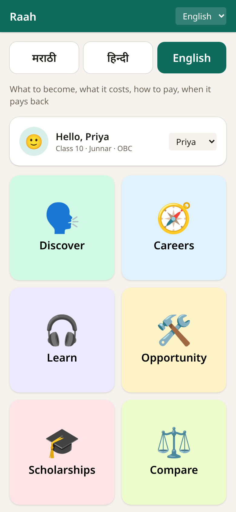
  
  
</p>

---

## Contents

- [Core idea: the AI explains, the data decides](#core-idea-the-ai-explains-the-data-decides)
- [Features](#features)
- [Screens](#screens)
- [The spreadsheet drives everything](#the-spreadsheet-drives-everything)
- [How the numbers are calculated](#how-the-numbers-are-calculated)
- [Sign-in and roles](#sign-in-and-roles)
- [AI conversation](#ai-conversation)
- [Architecture](#architecture)
- [Run it locally](#run-it-locally)
- [API](#api)
- [Project structure](#project-structure)
- [Adding a language, a scheme or a career](#adding-a-language-a-scheme-or-a-career)
- [Tests](#tests)
- [Data sources](#data-sources)
- [Licence](#licence)

---

## Core idea: the AI explains, the data decides

Eligibility, costs, payback months, distances and career ranking are computed by plain code from a curated dataset (`raah-dataset.xlsx`). Language models and voice are only used to talk, collect the profile and explain results. Every figure on screen carries a link to the page it came from and the date it was checked.

## Features

### Student

| Feature | What it does |
|---|---|
| **Language picker + icon home** | Marathi, Hindi, English. Big icon tiles for Discover, Careers, Learn, Opportunity, Scholarships and Compare. |
| **Discover chat** | When a language model is reachable, Raah holds a free conversation ("I'm Asha, 15, in Class 10 and I like computers") and shows the fields it understood as chips under each reply. Otherwise, or with one tap, it asks 12 short scripted questions (name, age, class, interests, marks, taluka, category, family income, travel limit, hostel, documents). Answer chips for low-literacy use; mic on every question. |
| **Why this career** | Each shortlisted career gets a one or two sentence reason. The model writes it from the score breakdown and dataset rows; if its text contains a number that is not in those rows, the template sentence is shown instead. |
| **Parental consent** | Students under 18 need a parent's OTP before the profile is saved. A consent record with purpose and timestamp is stored (DPDP Act 2023). |
| **Career shortlist** | Top 5 out of 40 careers, scored on interest match (50%), eligibility (20%), affordability (20%) and local demand (10%). The top 5 always includes at least one vocational and one non-STEM or self-employment option. |
| **Cost & payback card** | Course fees, exam fees, materials, travel or hostel, scholarship cover, stipend while training, net family cost, monthly income range and the payback month at typical and low income. |
| **What-if planner** | Toggle the scholarship, pick which scheme counts, move the commute slider, switch to hostel, set a monthly family contribution, or compare against leaving school for daily-wage work. Recalculates instantly, offline. |
| **Side-by-side compare** | Any two paths in two columns plus a cumulative cash chart with break-even marked. |
| **Scholarship check** | 17 central and Maharashtra schemes checked rule by rule (✅ ❌ ❔ 📄). Names the missing document and where to get it (tehsil office, Aaple Sarkar Seva Kendra, school). |
| **Nearest training centres** | 3 nearest Govt ITIs or nursing schools for the chosen path with distance, fees and source. |
| **Parent voice note** | A short message for parents in the chosen language with the plan's numbers, played aloud and shareable on WhatsApp as text or as an audio file. With BHASHINI keys the file is generated speech (WAV); without them the student records the message in their own voice. On phones the file goes to the share sheet (WhatsApp, Bluetooth, Files); elsewhere it downloads. |
| **Audio lessons + quiz** | "What is an ITI?", "What is an apprenticeship?", "How do scholarships work?" plus a 5-question quiz. Facts inside lessons and quiz (stipend rates, income limits, ITI count) come from the dataset. With BHASHINI keys, "Save lesson audio for offline" stores each lesson as an audio file on the phone; the file is tied to the exact lesson text, so after a dataset edit the new figures are spoken rather than an old recording. Without keys the phone's own voice reads them, which also works offline. |
| **Apprenticeships** | 31 live NAPS listings in Pune district and 17 Central Railway seat lines, searchable, with stipend and apply link. |
| **Exams** | Every entrance test or admission round a path needs shows as a step on the plan screen, and the Exams screen lists them all with who can apply, how selection works, the fee for open and reserved categories, when to apply and the official site. All of it comes from the `Exams` sheet. |
| **Offline + sync** | Installable PWA. Dataset, profile, plan, lessons and quiz answers work offline; queued actions sync on reconnect with a "N changes synced" toast. |
| **Delete my data** | One tap clears everything stored on the phone. |
| **Teacher recommendations** | When a teacher recommends a scheme, the student sees it on the home screen with the plan it was for and any missing document. "Check" opens the scholarship screen with that scheme first. Cached on the phone so it still shows offline. |

<p align="center"></p>

<p align="center">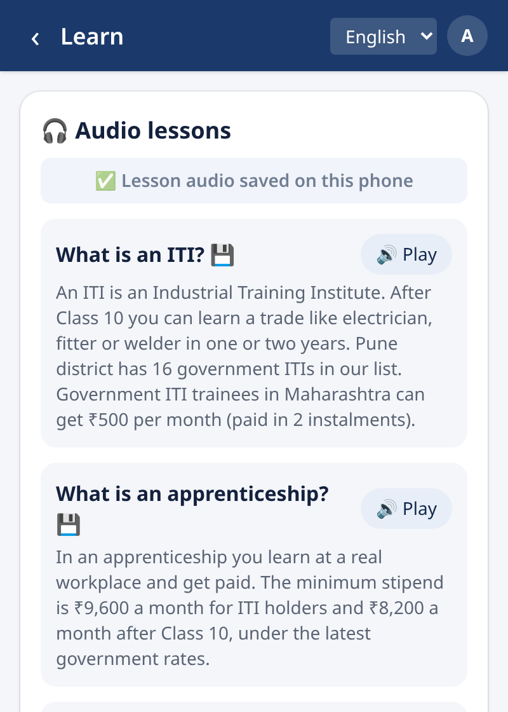</p>

<p align="center">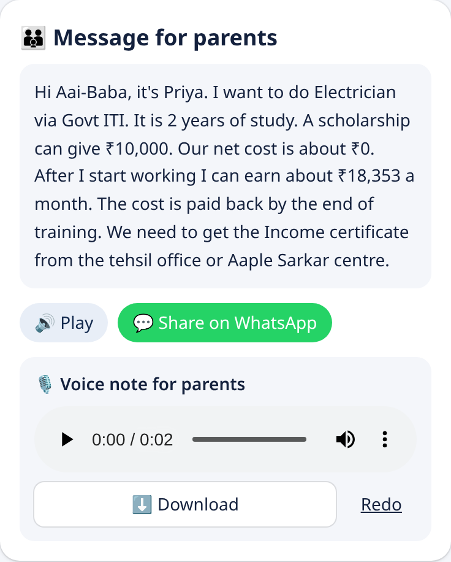</p>

<p align="center"></p>

### Teacher

| Feature | What it does |
|---|---|
| **Class dashboard** | 40 students with profile completion, top interests and each student's best-fit career. |
| **Dropout-risk flags** | Logistic regression (scikit-learn) with the top two reasons per student, e.g. "attendance fell 26% this term; an older sibling already left school to work". Trained on a synthetic class. |
| **Talent flags** | High quiz score with strong marks. |
| **Recommend to all eligible** | Pick a scheme and a path, see how many students qualify (and how many still need a document), send to all in one tap. Students who signed up and saved a profile are checked with the same rules as the demo class and receive the recommendation in their app. |

### Money layer (sandbox)

| Feature | What it does |
|---|---|
| **Family bank check** | Account Aggregator style consent, synthetic deposit data in the ReBIT FI schema, then: account active, income band matches declared income, ready for DBT. |
| **ISO 20022 payouts** | Scholarship, stipend and teacher payouts generated as `pain.001.001.09` XML with a viewer, validation and an initiated → accepted → credited ledger. The scholarship amount is read from the dataset. |
| **Skills passport** | Completed lessons and quiz scores issued as a signed W3C Verifiable Credential / Open Badge JSON. |
| **Partner APIs** | OAuth2 client-credentials for employers, colleges and NGOs: post opportunities, see anonymised candidates (contacts hidden until the student accepts), mark enrolments complete to trigger a teacher payout. |

## Screens

| Discover | Careers | What-if |
|---|---|---|
|  | 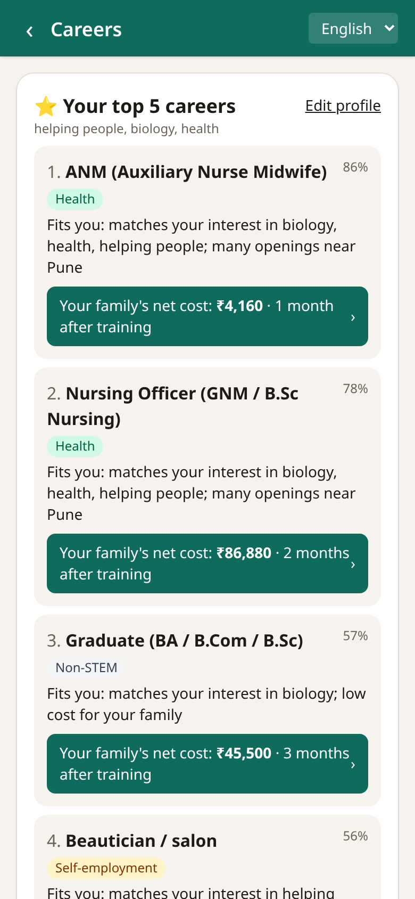 | 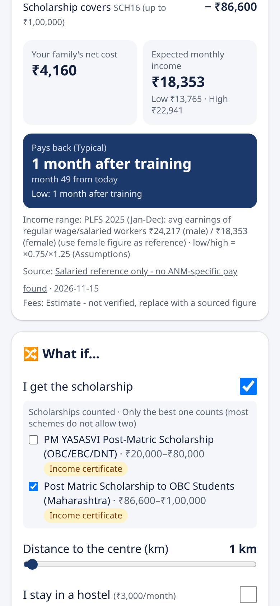 |

| Scholarship check | Parent voice note | Marathi |
|---|---|---|
| 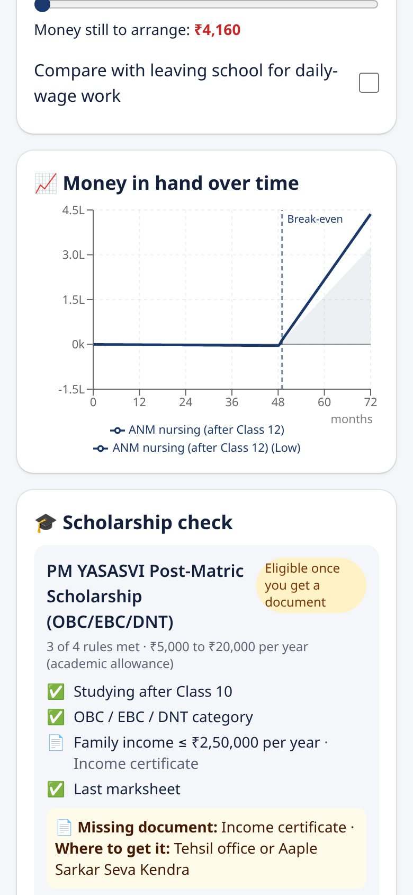 |  | 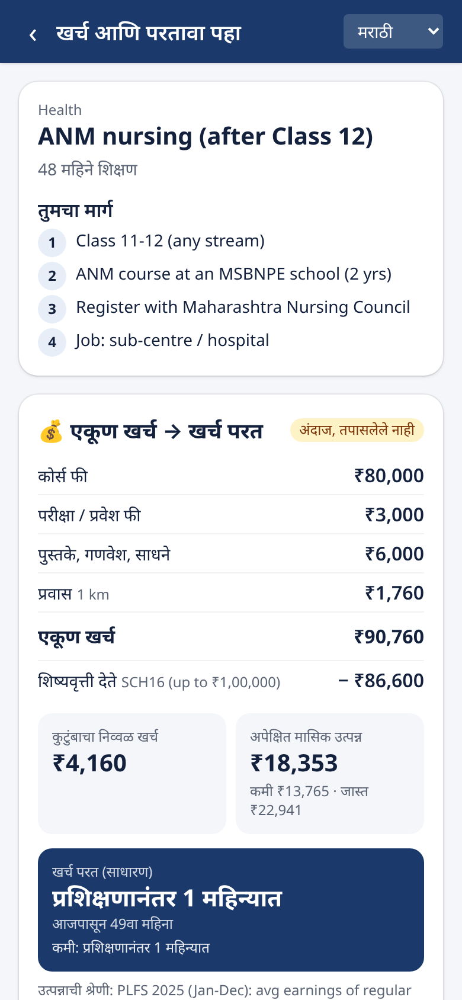 |

| Learn | Teacher dashboard | Money layer |
|---|---|---|
| 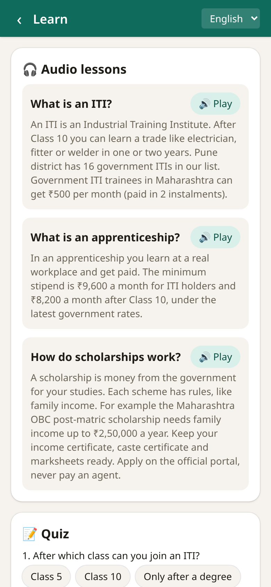 |  |  |

| Data sources |
|---|
|  |

## The spreadsheet drives everything

All figures are loaded from `raah-dataset.xlsx` at runtime. Editing a cell and saving updates the app within a few seconds, with no rebuild or restart.

1. `backend/raah/dataset.py` reads every sheet and converts text cells into numbers, for example `≤ ₹3,50,000 per year` → `350000`, `₹8,200-20,000/month` → `{low: 8200, high: 20000}`, `₹24,217 (male) / ₹18,353 (female)` → a value per gender, `Boys: 50% tuition; Girls: 100%` → fee share per gender.
2. The parsed data is cached and re-read whenever the file's modified time changes.
3. The app polls `/api/version` every 4 seconds and recalculates when the spreadsheet is saved, with a "Spreadsheet updated" toast.
4. Cells that cannot be converted are listed on the **Data sources** screen.
5. The phone keeps the last copy in IndexedDB for offline use.

### Dataset sheets

| Sheet | Used for |
|---|---|
| `Scholarships` | Scheme names, income limits, amounts, documents, apply links. The income limit and amount cells feed the rules and payback maths directly. |
| `Careers_Income` | 40 careers with income while training and after training. Row `CAR40` (casual daily wage) is the "dropping out" baseline. |
| `Apprenticeships_NAPS`, `Apprenticeships_Railway` | Opportunity screen. |
| `Stipend_Rates` | Minimum apprentice stipends used in lessons and quiz. |
| `Training_Centres` | Nearest-centre lookup. |
| `Courses` | Free courses per career; a course's fee can fill a plan's fee. |
| `Exams` | Entrance tests and admission rounds: ITI admission (DVET), polytechnic (DTE), MHT-CET, MH Nursing CET, NEET-UG, NMMS and the Central Railway apprentice notice, with who can apply, selection, application fee by category, last cycle dates, usual timing and official site. |
| `Assumptions` | Fare per km, study days per year, hostel cost per month, working days per month, low/high income factors, payback horizon, whether scholarships can be combined, months a monthly allowance is paid. |
| `Plan_Inputs` | One row per career path: course months, months earning while training, fees, exam fees, materials, course tags, centre type and the exams on the path (`EX01; EX07`). Blank income cells are taken from `Careers_Income`. |
| `Eligibility_Rules` | One row per rule. `@income` in the Value column links to that scheme's income limit in `Scholarships`. Operators: `in`, `any`, `has`, `is`, `<=`, `<`, `>=`, `>`. Category relaxations: `55; SC=50; ST=50`. |
| `Career_Profile` | Interest tags, minimum class and local demand per career, used for ranking. |
| `Talukas` | Taluka points used for distance while a centre has no Lat/Lon. Exact centre coordinates take priority once filled in. |
| `Demo_Students` | Hero profiles for the demo (Priya, Rohan, Sana). |

`backend/scripts/add_app_sheets.py` adds the app sheets to a workbook that does not have them yet and never overwrites a sheet that already exists.

## How the numbers are calculated

```
total_cost    = course_fees + exam_fees + materials
              + commute_km × 2 × fare_per_km × study_days_per_year × years      (or hostel_cost_per_month × months)
scholarship   = best eligible scheme (or the sum, if stack_scholarships = 1):
                fee share × fees (capped where the scheme has a cap)
              + per-year amount × years
              + per-month amount × months_paid_per_year × years
stipend       = lowest listed stipend × months earning while training
net_cost      = total_cost − scholarship − stipend
monthly_gain  = income (typical or low) − baseline          baseline = 0 for a student, or PLFS daily wage × working days
payback       = first month after training where cumulative gain ≥ net_cost
```

- Income uses the student's gender where the source splits it (PLFS male / female averages).
- When a source gives a single figure, low and high are that figure × `income_low_factor` / `income_high_factor` from `Assumptions`.
- Scholarship values use the lower end of a range so the payback is never overstated; the upper end is shown alongside.
- A scheme counts as eligible for the plan when every rule passes or the only gap is a document the student can still get.

## Sign-in and roles

Students and teachers sign in with their mobile number and a one-time password.

<p align="center">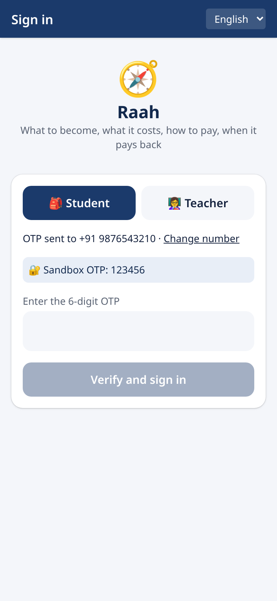</p>

| | Student | Teacher |
|---|---|---|
| Who can sign in | Anyone with a 10-digit Indian mobile number (account is created on first login) | Numbers listed in `RAAH_TEACHER_PHONES` |
| Screens | Discover, Careers, plans, Compare, Scholarships, Learn, Opportunity, Profile | Everything a student sees, plus Class dashboard and Money |
| Server access | Own profile, own synced activity, own AA consent | Class data, bulk recommend, pain.001 payouts and ledger, any consent |

- **OTP:** 6 digits, stored only as a salted SHA-256 hash, valid for 5 minutes, single use, 5 wrong tries lock it, and at most 3 requests per number every 10 minutes.
- **Sandbox mode:** with `SMS_PROVIDER` empty, the OTP is `RAAH_SANDBOX_OTP` (default `123456`) and the login screen shows it. Add an SMS gateway in `_send_sms` in `backend/raah/auth.py` for real delivery.
- **Tokens:** HS256 JWT signed with `RAAH_SIGNING_KEY`, carrying the user id and role, valid for `RAAH_TOKEN_TTL_DAYS` (default 30) so a signed-in student keeps working offline. A rejected token signs the app out.
- **Storage:** users, OTP challenges, saved profiles and synced activity live in SQLite at `RAAH_DB` (default `backend/data/raah.db`).
- **Profile sync:** profile edits and offline actions are queued on the phone and saved to the account on reconnect; signing in on a new phone restores the profile.
- **Delete my data:** removes the account, profile and synced activity on the server and clears the phone.
- **Open endpoints:** `/api/data`, `/api/version`, `/api/plan`, `/api/eligibility`, `/api/careers` and `/api/centres` stay public because they only serve the published dataset and run the same maths the phone runs offline.
- **Partners** use a separate OAuth2 client-credentials flow (below).

Demo logins: any student number (e.g. `9876543210`), teacher `9000000001`, OTP `123456`.

## AI conversation

<p align="center">
  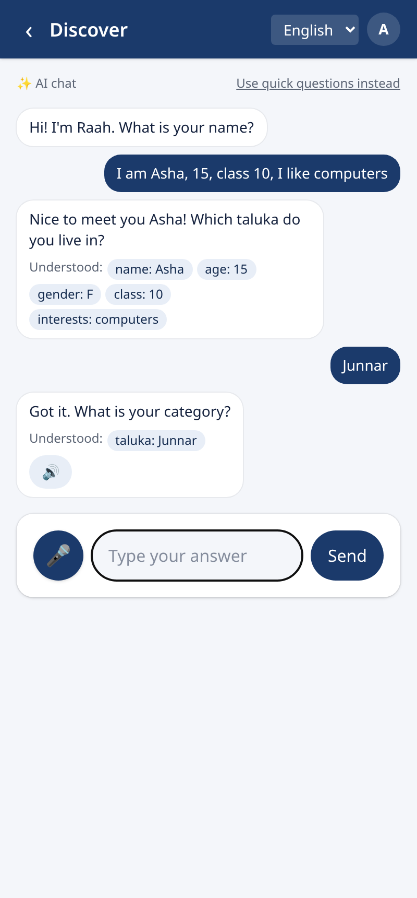
  
</p>

Raah uses open-source models through any OpenAI-compatible chat API. Providers are tried in the order set in `LLM_PROVIDERS`; one that fails is skipped for 60 seconds so a stopped local server does not slow the app.

| Provider | Model (default) | Variables |
|---|---|---|
| `ollama` | `gemma4:12b`, running on your own machine | `OLLAMA_URL`, `OLLAMA_MODEL` |
| `groq` | `llama-3.3-70b-versatile` | `GROQ_API_KEY`, `GROQ_MODEL` |
| `sarvam` | `sarvam-m` (Indian languages) | `SARVAM_API_KEY`, `SARVAM_MODEL` |

**Profile extraction** (`POST /api/chat/turn`). The model gets the conversation, the profile so far, the fields still missing and the allowed values (categories, talukas and interest tags from the spreadsheet). It replies with its next question and the fields it learned. Every field is validated on its own with Pydantic: an age of 40, marks of 300 or an unknown category is dropped and reported in `rejected`, while the valid fields are kept. Talukas and interests are matched to the spreadsheet's names. The model is told never to state fees or amounts.

**Grounded reasons** (`POST /api/chat/explain`). The server ranks careers with the same engine as the app, then gives the model only that career's facts: score breakdown, matched interests, entry path, net cost and payback from the dataset. Every number in the model's answer must appear in those facts, otherwise the template reason is returned.

**Interest matching** (`POST /api/interests/match`). Students describe what they enjoy in their own words and language, for example "मला गाड्या दुरुस्त करायला आवडतं" (I like repairing vehicles). A multilingual embedding model maps the sentence to the closest career tags in the spreadsheet, here "fixing things" and "vehicles"; the matched tags appear as chips under the answer. Ranking still runs on tags, so it stays identical online and offline. Providers are tried in the order of `EMBED_PROVIDERS`: Ollama's `/api/embed` with `bge-m3` (run `ollama pull bge-m3` once), then `sentence-transformers` with `intfloat/multilingual-e5-small` if that package is installed. Without either, words are matched against the tags. Tag embeddings are cached per model and per tag list, so a tag edited in the spreadsheet is embedded again on the next request.

<p align="center">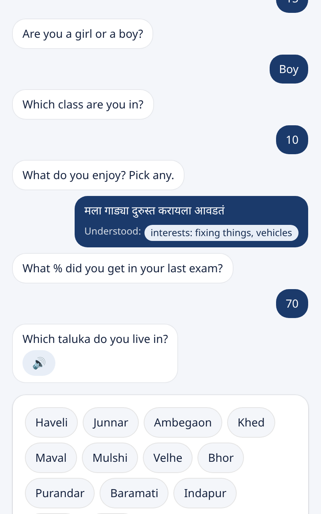</p>

**Fallback.** With no provider reachable, offline, or when the student taps "Use quick questions instead", the scripted questions take over and skip whatever the conversation already filled in. Nothing else in the app depends on a model.

To use your local Ollama:

```bash
ollama pull gemma4:12b
# backend/.env
LLM_PROVIDERS=ollama
OLLAMA_MODEL=gemma4:12b
```

## Architecture

```
 Phone (low-end Android, Chrome)
 ┌────────────────────────────────────────────┐
 │ Next.js PWA (static export, React, Tailwind)│
 │  · service worker: app shell + dataset      │
 │  · IndexedDB (Dexie): data, profile,        │
 │    consent, quiz answers, sync queue        │
 │  · lib/engine.ts: payback, what-if,         │
 │    eligibility, ranking (offline)           │
 │  · Web Speech API voice fallback            │
 └──────────────────┬─────────────────────────┘
                    │ HTTPS
 ┌──────────────────▼─────────────────────────┐
 │ FastAPI                                     │
 │  /api/data /api/version  parsed spreadsheet │
 │  /api/plan /api/eligibility /api/careers    │
 │  /api/centres            raah/engine.py     │
 │  /api/voice              BHASHINI ASR / TTS │
 │  /api/teacher            class, flags, bulk │
 │  /api/money              AA, pain.001, VC   │
 │  /api/partners           OAuth2 + OpenAPI   │
 └──────────────────┬─────────────────────────┘
                    │
             raah-dataset.xlsx
```

The same logic exists in Python (`backend/raah/engine.py`, used by the API) and TypeScript (`web/lib/engine.ts`, used offline in the browser). A parity test runs both on 105 scenarios and requires identical results.

**Stack:** Next.js 16, React 19, Tailwind CSS 4, Recharts, Dexie · FastAPI, Pydantic, openpyxl, scikit-learn, NumPy, lxml, PyJWT, httpx · BHASHINI (ULCA) for Indian-language speech.

## Run it locally

Requirements: Python 3.10+. Node 20+ only if you want to change the web app.

```bash
git clone https://github.com/sanikadeokule/raah-citi-hack.git
cd raah-citi-hack
cp backend/.env.example backend/.env      # optional: BHASHINI keys, signing key, partner credentials
./run.sh
```

Open <http://localhost:8000>. On a phone connected to the same Wi-Fi, open `http://<laptop-ip>:8000` and use "Add to Home screen" to install it.

By default the backend looks for `raah-dataset.xlsx` in the repository root or the folder above it. Point it anywhere with `RAAH_DATASET=/path/to/raah-dataset.xlsx`.

### Working on the web app

```bash
cd web
npm install
NEXT_PUBLIC_API_BASE=http://localhost:8000 npm run dev    # http://localhost:3000 with hot reload
npm run build                                             # writes web/out, which the backend serves
```

### Voice

With `BHASHINI_USER_ID` and `BHASHINI_API_KEY` in `backend/.env`, text-to-speech and speech-to-text go through BHASHINI. Generated speech is cached on the server in `RAAH_TTS_CACHE` (default `backend/data/tts`), so each lesson or message is synthesised once, and lesson audio can be saved on the phone for offline listening. Without keys the app uses the browser's built-in voices (`mr-IN`, `hi-IN`, `en-IN`).

### ISO 20022 validation

Run `python scripts/fetch_iso_schema.py` from `backend/` once. It downloads the official `pain.001.001.09.xsd` from the ISO 20022 message catalogue into `backend/schemas/` and checks its namespace. From then on every generated payment file is validated against the official schema, and the payment response and ledger show `official XSD pain.001.001.09` with any errors by line. If the download is blocked, save the file there by hand (or point `RAAH_PAIN001_XSD` at it). Without the file, structural checks run instead.

## API

Interactive OpenAPI docs: <http://localhost:8000/docs>

| Method & path | Purpose |
|---|---|
| `GET /api/data` | Whole parsed dataset (ETag-cached) |
| `GET /api/version` | Spreadsheet modified time, polled for live reload |
| `POST /api/plan` | Cost & payback for `{profile, plan_id, options}` |
| `POST /api/eligibility` | Rule-by-rule results for a profile, optionally for a plan |
| `POST /api/careers` | Top-N careers with score breakdown and reason |
| `POST /api/centres` | Nearest centres of a type |
| `POST /api/voice/tts`, `/api/voice/asr` | BHASHINI speech |
| `GET /api/teacher/class` | Class with risk and talent flags |
| `GET /api/teacher/eligible/{scheme}` · `POST /api/teacher/recommend` | Bulk recommend |
| `POST /api/money/aa/consent` · `GET /api/money/aa/fi-data` | Consent and synthetic FI data |
| `POST /api/money/payments` · `GET /api/money/ledger` | pain.001 generation and status |
| `POST /api/money/passport` | Signed skills passport |
| `POST /api/partners/token` | OAuth2 client-credentials token |
| `POST /api/partners/opportunities` · `GET /api/partners/candidates` | Partner posting and masked candidates |
| `POST /api/partners/enrolments/{id}/complete` | Completion → teacher payout |
| `GET /api/chat/status` | Whether a language model is reachable |
| `POST /api/chat/turn` | Next question plus validated profile fields from the conversation |
| `POST /api/interests/match` | Closest career tags for free-text interests in any language |
| `POST /api/chat/explain` | Model-written match reason, checked against the dataset's numbers |
| `POST /api/auth/otp/request` · `POST /api/auth/otp/verify` | Phone OTP login, returns a JWT |
| `GET /api/auth/notifications` · `POST /api/auth/notifications/{id}/read` | Recommendations sent to the signed-in student |
| `GET /api/auth/me` · `GET`/`PUT /api/auth/profile` · `DELETE /api/auth/me` | Account, saved profile, delete my data |
| `POST /api/sync` | Actions queued while offline (signed in) |

Example:

```bash
curl -s -X POST localhost:8000/api/plan -H 'Content-Type: application/json' \
  -d '{"profile":{"gender":"F","class":10,"category":"OBC","family_income_annual":180000,"lat":19.2,"lon":73.88,"documents":["caste_certificate","marksheet_10"],"domicile":"Maharashtra"},"plan_id":"PLN03","options":{"commute_km":20}}'
```

## Project structure

```
backend/
  raah/
    dataset.py      spreadsheet loader and text-to-number parsing, reload on save
    engine.py       eligibility, cost & payback, centres, career ranking
    main.py         FastAPI app, core routes, serves web/out
    auth.py         phone OTP login, JWT roles, users and profiles in SQLite
    voice.py        BHASHINI ASR / TTS
    teacher.py      synthetic class, dropout model, bulk recommend
    money.py        pain.001, Account Aggregator mock, skills passport
    partners.py     OAuth2 partner endpoints
  scripts/add_app_sheets.py
  tests/            parity and spreadsheet-edit tests
web/
  app/              one folder per screen
  components/       shared UI, payback card, what-if, chart, scheme result
  lib/              engine.ts, store (data, profile, sync), db (IndexedDB), lessons
  locales/          en.json, mr.json, hi.json
  public/           service worker, manifest, icon
  out/              prebuilt static export
docs/screenshots/
run.sh
```

## Adding a language, a scheme or a career

- **Language:** copy `web/locales/en.json` to `web/locales/<code>.json`, translate the values, and add the code to `LANGS` in `web/lib/store.tsx`.
- **Scholarship:** add a row to `Scholarships`, then its rules to `Eligibility_Rules` (use `@income` for the income limit). No code change.
- **Career path with a cost plan:** add the career to `Careers_Income` and `Career_Profile`, and a row to `Plan_Inputs`.
- **Training centre coordinates:** fill `Lat` and `Lon` in `Training_Centres`.

## Tests

```bash
cd backend
pip install -r requirements.txt pytest
RAAH_DATASET=../raah-dataset.xlsx python -m pytest -q tests
```

- `test_parity.py`: Python and TypeScript engines agree on 105 scenarios (3 students × 7 plans × 5 what-if settings), including eligibility and ranking.
- `test_auth.py`: OTP login, wrong-code lockout, single use, rate limit, teacher allowlist, role checks on teacher and money endpoints, consent ownership, profile sync and account deletion.
- `test_data_driven.py`: edits a copy of the spreadsheet (income limit, course fee, income, assumption) and checks the eligibility, cost, payback and cached data change accordingly.

## Data sources

National Scholarship Portal, MahaDBT, Ministry of Social Justice & Empowerment, Ministry of Education, AICTE, DST INSPIRE, apprenticeshipindia.gov.in (NAPS), RRC Central Railway, DGT stipend notification (Sep 2025), DVET Maharashtra, MSBNPE, PLFS 2025 (MoSPI), PIB, India Post, Skill India Digital Hub, SWAYAM and DIKSHA. Each row in the spreadsheet links to its exact source page and check date.

The teacher's class, the dropout model's training data and the family bank data are synthetic.

## Licence

[MIT](LICENSE)
